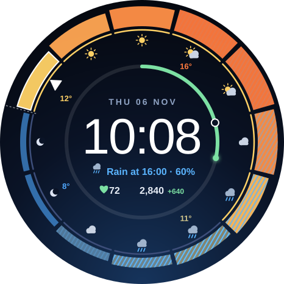
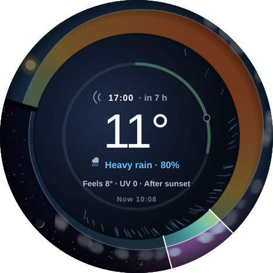
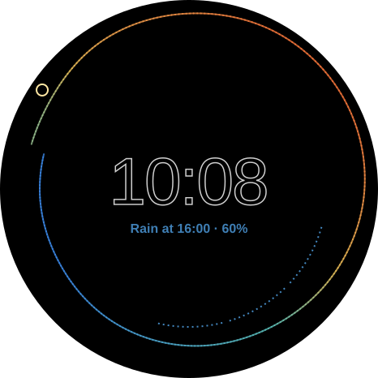

# Horizon: flagship concept

> **A 12-hour weather landscape wrapped around the dial, with the sun as the hour hand.**
> Look at 4 o'clock to see the weather at 4 pm.

| Active | Tilt to scrub | Always-on |
|---|---|---|
|  |  |  |

*Mockups show Thu 06 Nov, 10:08, with sample forecast data. Drawn by `tools/render_horizon.py`.*

## The idea

Each hour position on the dial shows the weather for the next time that hour
comes around. Together the 12 positions form one continuous scene, and it
rolls forward every hour:

- **The ground is temperature.** It rises over warm hours and dips over cold
  ones, and its colour runs from cold blue to warm orange.
- **The sky is time of day.** Day blue changes to dusk violet at sunset, then
  to a starry night with the moon in its real phase.
- **The weather is placed where it will happen.** Clouds sit on the horizon
  over cloudy hours, and rain falls under rainy hours. The more likely the
  rain, the denser it falls.
- **The sun is the hour hand.** It moves through the sky above the current
  hour, lights the dial from its side, and makes the time digits cast a
  shadow that swings around over the day.

## Anatomy

| # | Element | What it tells you |
|---|---|---|
| 1 | Terrain | The temperature curve for the next 12 hours, shown by height and colour |
| 2 | Sun | The hour hand, which is also where "now" is in the sky |
| 3 | Sky, clouds, stars, moon | Day, dusk and night; cloud cover; the moon's phase |
| 4 | Falling rain | When rain is likely, and how likely |
| 5 | Seam | Where now meets +12 h |
| 6 | Sun-cast shadow | The direction of the light, which changes with the time of day |
| 7 | Pace ghost | Where your step count should be by now to reach today's goal |
| 8 | Rain countdown | "Rain at 16:00 · 60%", or "Dry for the next 12 h" |
| 9 | Vitals | Heart rate coloured by zone, steps, and how far ahead of or behind pace you are |

## Features

- **Tilt to scrub.** Tilt your wrist and a cursor moves around the ring. The
  rest of the landscape dims, and the centre shows that hour's temperature,
  feels-like, rain chance and UV. Level your wrist and it goes back to the
  time. It needs no taps.
- **Moving weather.** In active mode, rain falls, clouds drift and stars
  twinkle, only under the hours they're forecast for. All of it stops in
  always-on mode.
- **Rain countdown.** Worked out on the watch from the hourly forecast.
- **Step pace ghost.** Compares your steps with your own wake and sleep hours,
  so you can tell whether you're on track.
- **HR zone colour.** Five zones based on the max heart rate you set.
- **No-weather fallback.** Without weather data it becomes a calm 12-hour dial
  with step pace, never an empty ring.
- **Always-on mode.** Shows the crest line in temperature colours, rain dashes,
  an outline of the sun, and the time. About 6% of pixels are lit, and
  everything shifts slightly every minute to prevent burn-in.

### Customize menu

| Option | Values |
|---|---|
| Band shows | Temperature · Rain chance · UV index |
| Units | °C · °F |
| Colour scale | Thermal · Mono · Colour-blind safe (blue–yellow) |
| Wake / sleep hours | Used for the pace ghost (default 07:00–22:00) |
| Max heart rate | Used for zone colours (default 190) |
| Tilt to scrub | On · Off |
| Weather motion | Full · Subtle · Still |
| Left / right slot | 2 complication slots, e.g. calendar or battery |

## How it's built (Watch Face Format, no app code)

| Problem | Approach |
|---|---|
| The ring rolls every hour | Build the segments by offset (now … +11 h), then rotate the whole group by `HOUR_0_23 × 30°`. Each segment reads one fixed source, `WEATHER.HOURS.<n>`. |
| A continuous terrain | Thin slices whose radius and colour are interpolated between neighbouring hours using expressions. |
| Tilt to scrub | Map the accelerometer tilt angle to a 0–11 hour index, with a dead zone so a level wrist shows the time. The cursor, the dimming and the centre text are all chosen by that index. |
| Moving rain, clouds and stars | Repeating transforms driven by seconds, shown only on hours whose forecast matches, and removed from the always-on layout. |
| Sun-cast shadow | Offset the digits' shadow by `−sin` and `cos` of the sun's angle, the same expression that positions the sun. |
| Rain countdown | A chain of 12 `Condition` blocks evaluated in order; the first hour that matches wins. |
| Pace ghost | A `Transform` angle of (minutes since wake ÷ waking minutes) × 360°, clamped to the waking window. |
| Hundreds of repeated XML elements | A Python generator writes `watchface.xml` from one geometry spec. |

## Risks, tested first

1. **Which weather fields the Watch 3 exposes, and how many hours ahead.**
   Everything depends on this. If hourly rain chance is missing, the rain
   features fall back to the hourly condition.
2. **Tilt data inside a watch face.** If it isn't available, scrubbing falls back
   to two tap zones (earlier and later), and the rest of the face is unaffected.
3. **Arc radius driven by an expression.** If WFF won't do it, each slice
   becomes a stack of thin arcs, each shown or hidden by a threshold, like an
   equaliser.
4. **Render cost.** The landscape is about 300 slices plus moving weather. It
   will be measured with Google's memory-footprint tool, and the slice count
   lowered if needed.

## Plan (about 8 working days)

| Day | Work |
|---|---|
| 1 | Project, Gradle and CI. Test the weather fields and the tilt sensor on the watch. Validator and memory checker. |
| 2 | XML generator. Terrain with continuous height and colour, and the rolling-hour rotation. |
| 3 | Sky: day, dusk and night colours, stars, the moon's phase, and clouds on the horizon. |
| 4 | The sun as hour hand, light and shadow, seam, falling rain. |
| 5 | Tilt to scrub: tilt mapping, cursor, dimming, hour detail panel. |
| 6 | Centre layout, rain countdown, pace ghost, HR zones, complication slots. |
| 7 | Customize options, no-weather fallback, always-on mode, burn-in shift, motion levels. |
| 8 | Testing on the watch at dawn, midday, dusk and night, in rain and with no data. Battery and memory checks, release, install guide. |

## Where the ceiling is

This is close to the most a Watch Face Format face can do. WFF has no code,
no network access, no history and no location. The next step up is a small
companion app on the watch that supplies data to the face. That's about 4–6
more days, a second APK, and location permission. It would add:

- real sunrise and sunset, and where the sun and moon actually are in your sky;
- minute-by-minute rain ("starts in 14 min"), air quality and pollen;
- today's heart rate traced along the ground as a second ridge.
