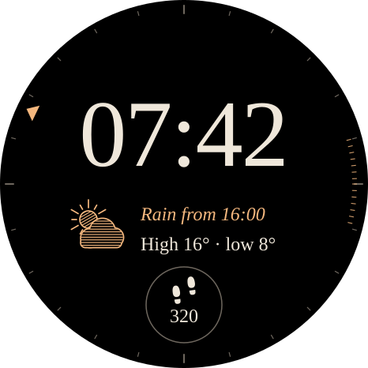
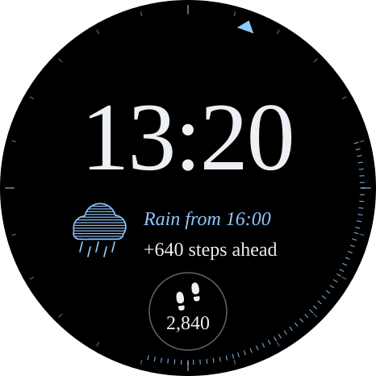
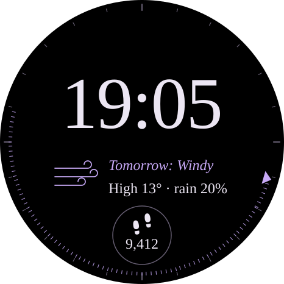
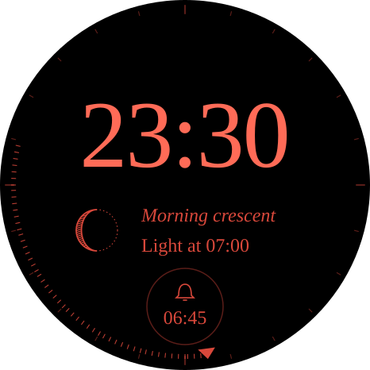
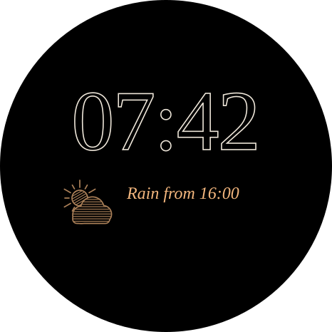
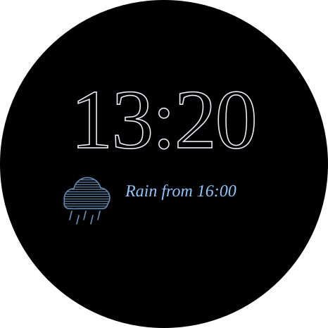
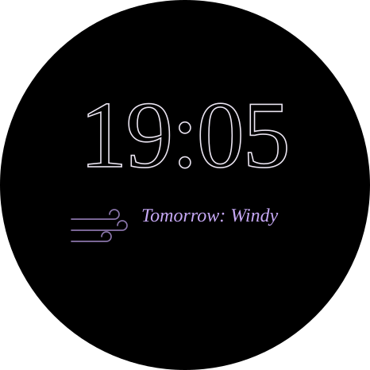
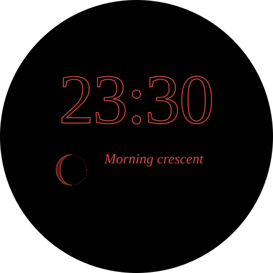

# Almanac

> **A pocket almanac for today.** The time and frame stay fixed all day. Underneath, one
> engraved "plate" changes with the part of the day, so the face shows what matters right now.

| Morning | Day | Evening | Night |
|---|---|---|---|
|  |  |  |  |
|  |  |  |  |

*Top row: active mode. Bottom row: always-on mode. Sample data for Thu 6 Nov. Drawn by `tools/almanac_render.py` and checked by
`tools/almanac_audit.py` against [ACCEPTANCE.md](ACCEPTANCE.md). Results are in [AUDIT.md](AUDIT.md).*

## The idea

Most faces show the same widgets at 07:00 and at 23:00, but you need different
things at those times. Almanac keeps **one constant frame**: the time is always
in the same place, at the same size, in the same typeface. **Only the plate
underneath changes**, and it answers the question that fits the time of day.
The look comes from old printed almanacs: engraved line illustrations, a
classical serif, and ink colours that change through the day. At night,
everything turns deep red to protect your night vision.

## The four parts of the day

The part-of-day boundaries follow your wake and sleep hours, which you set in
Customize. The default is 07:00–22:00: morning runs from waking until 11:00,
day until 18:00, evening until sleep, and night until waking.

| Part | Ink | Glance questions it answers | Plate |
|---|---|---|---|
| **Morning** | Apricot | Will it rain today, and when? How warm will it get? | Glyph for today's main condition · *"Rain from 16:00"* · "High 16° · low 8°" |
| **Day** | Daylight blue | What's coming next? Am I on track with steps? | Glyph for the next change · *"Rain from 16:00"* · "+640 steps ahead" |
| **Evening** | Lavender | What's tomorrow like? | Tomorrow's glyph · *"Tomorrow: Windy"* · "High 13° · rain 20%" |
| **Night** | Red | When does it get light? What's the moon doing? | Engraved moon phase · *"Morning crescent"* · "Light at 07:00" |

Present in every part of the day:
- the **day label** along the top arc;
- the **time** (Fraunces, 120 px, the same position everywhere);
- the **24-hour light scale**, with noon at the top and midnight at the bottom.
  It has engraved hatching over the hours of darkness in the next 12 h, so
  you can see how much daylight is left;
- the **now marker**;
- **one complication slot**, 96 px across (48 dp), with steps as the default.

## Anatomy (morning)

| # | Element | Data |
|---|---|---|
| 1 | Day label: part of the day and date | Part of the day from `HOUR_0_23` and your wake and sleep settings; date from `DAY_OF_WEEK_S`, `DAY`, `MONTH_S` |
| 2 | Time | `HOUR_0_23_Z` / `HOUR_1_12_Z`, chosen by `IS_24_HOUR_MODE`, plus `MINUTE_Z` |
| 3 | 24 h light scale | `WEATHER.HOURS.{0..11}.IS_DAY` |
| 4 | Now marker | `HOUR_0_23_MINUTE` |
| 5 | Engraved glyph | `WEATHER.DAYS.0.CONDITION_DAY` (morning), the first hour whose `WEATHER.HOURS.n.CONDITION` changes (day), `WEATHER.DAYS.1.CONDITION_DAY` (evening), `MOON_PHASE_POSITION` (night) |
| 6 | Line A, the headline in italic | The first hour with precipitation: `WEATHER.HOURS.n.CONDITION_NAME` plus that hour, or the localised day or moon name |
| 7 | Line B, the supporting figure | `WEATHER.DAY_TEMPERATURE_HIGH/LOW` · steps pace · `WEATHER.DAYS.1.TEMPERATURE_HIGH` + `CHANCE_OF_PRECIPITATION` · first `IS_DAY` hour |
| 8 | Complication | A system complication slot, chosen by the user |

## Data honesty (gate G1)

Every value on screen comes from a documented Watch Face Format data source
([reference](https://developer.android.com/reference/wear-os/wff/common/attributes/source-type)),
or is calculated from one.

| On screen | Source |
|---|---|
| "Rain from 16:00" | The first `n` in 0–11 where `WEATHER.HOURS.n.CONDITION` is a precipitation code (4, 5, 6, 7, 9, 10, 11, 12). The name comes from `CONDITION_NAME` and the hour is `(HOUR_0_23 + n) % 24` |
| "High 16° · low 8°" | `WEATHER.DAY_TEMPERATURE_HIGH`, `WEATHER.DAY_TEMPERATURE_LOW`, with the unit from `WEATHER.TEMPERATURE_UNIT` |
| "+640 steps ahead" | `STEP_COUNT − STEP_GOAL × clamp((HOUR_0_23_MINUTE − wake) / (sleep − wake))` |
| "Tomorrow: Windy", "rain 20%" | `WEATHER.DAYS.1.CONDITION_DAY_NAME`, `WEATHER.DAYS.1.CHANCE_OF_PRECIPITATION`, `WEATHER.DAYS.1.TEMPERATURE_HIGH` |
| "Morning crescent" | `MOON_PHASE_TYPE_STRING` |
| "Light at 07:00" | The first `n` where `WEATHER.HOURS.n.IS_DAY` is true |
| "No forecast yet" / "Last update failed" / "Forecast 6 h old" | `WEATHER.IS_AVAILABLE`, `WEATHER.IS_ERROR`, `UTC_TIMESTAMP − WEATHER.LAST_UPDATED` |

**Not used, because WFF doesn't provide it:** hourly rain chance, feels-like
temperature, sunrise and sunset times, and location. Earlier concepts in this
repo made those mistakes. Almanac avoids them.

## Weather vocabulary (gate G4)

All 16 `WEATHER.CONDITION` values have their own engraved glyph, and clear and
partly cloudy also have night versions. The files are `previews/almanac/glyph-*.svg`.

| Code | Condition | Glyph |
|---|---|---|
| 0 | Unknown | Dashed ring with a dash (honest "unknown") |
| 1 | Clear | Open sun with 8 rays (by day), or a hatched moon with stars (by night) |
| 2 | Cloudy | Two hatched clouds |
| 3 | Fog | Four solid wave lines |
| 4 | Heavy rain | Densely hatched cloud with 8 long streaks |
| 5 | Heavy snow | Dense cloud, 7 flakes and a drift line |
| 6 | Rain | Cloud with 5 streaks |
| 7 | Snow | Cloud with 5 flakes |
| 8 | Sunny | Hatched sun with 16 rays |
| 9 | Thunderstorm | Dense cloud, hatched bolt and streaks |
| 10 | Sleet | Cloud with streaks and flakes mixed |
| 11 | Light snow | Cloud with 3 flakes |
| 12 | Light rain | Cloud with 3 short streaks |
| 13 | Mist | Three dashed wave lines |
| 14 | Partly cloudy | Hatched sun, or moon, behind a cloud |
| 15 | Windy | Three curling wind lines |

## Every state (gate G5)

| State | Trigger | What changes |
|---|---|---|
| Morning, day, evening, night | The clock and your wake and sleep settings | The plate content and the ink colour |
| Always-on (×4) | System ambient mode | Outlined time, glyph at 70%, italic headline only. The audit measured 3.4–4.0% of pixels lit, against Google's 15% limit |
| No data | `WEATHER.IS_AVAILABLE` is false | Dashed "unknown" glyph · *"No forecast yet"* · "Check connection" · no hatching on the scale |
| Stale | The forecast is more than 3 h old | The hatching fades · line B "Forecast 6 h old" |
| Error | `WEATHER.IS_ERROR` with old data still present | The old data stays on screen · line B "Last update failed" |

## Customize menu (S11)

| Option | Values |
|---|---|
| Wake / sleep | 05:00–10:00 / 20:00–01:00, in 30-minute steps |
| Inks | Almanac (four colours) · Mono white |
| Night ink | Red (default) · Same as evening |
| Light scale | On · Off |
| Complication | Any system complication (default: steps) |

12/24 h, the temperature unit, and condition, day and month names all come from the system (S10).

## How it's built in Watch Face Format (S12)

| Mechanism | WFF element |
|---|---|
| Switching parts of the day | A `Condition` on `HOUR_0_23_MINUTE` against the wake and sleep `ListConfiguration` values |
| Curved day label | `PartText` with `TextCircular` |
| Engraved glyphs | `Image` resources (vector drawable or PNG), chosen by a `Condition` on the condition code |
| Moon phase | 28 pre-drawn phase images, indexed by `MOON_PHASE_POSITION` |
| "Rain from 16:00" and "Light at 07:00" | A chain of 12 `Condition` blocks over `WEATHER.HOURS.n.*`, with the result in a `Template` and `Parameter` expression |
| Light-scale hatching | 12 `PartDraw` arc segments, rotated to the current hour, each shown or hidden by `WEATHER.HOURS.n.IS_DAY` |
| Steps pace | An arithmetic expression on `STEP_COUNT`, `STEP_GOAL` and `HOUR_0_23_MINUTE` |
| Always-on mode | `Variant mode="AMBIENT"` on each layer |

None of this has run on a Watch 3 yet, so S12 scores 0.5 by the rules.

## Risks, tested first

1. **How many hours of forecast the Watch 3 provides.** The docs don't say. If
   fewer than 12 are available, the scale hatching and "from HH:00" search only
   cover what there is, and the scale marks the unknown hours as dotted.
2. **Whether the watch can render `TextCircular` with the Newsreader font**,
   or whether the font needs embedding.
3. **Translations.** The fixed phrases ("Rain from", "High", "Light at") need
   translating for each language. Until then S10 scores 0.75.

## Plan (about 8 working days)

| Day | Work |
|---|---|
| 1 | Project, CI, Google's validator and memory checker. Device test: forecast hours, `TextCircular`, fonts |
| 2 | Generator and frame: time, day label, 24 h light scale, now marker |
| 3 | Engraved glyph set: 16 conditions, night versions, 28 moon phases, exported as resources |
| 4 | Part-of-day logic and the four plates (Conditions and Templates) |
| 5 | Pace, complication, no-data / stale / error states, always-on mode for each part of the day |
| 6 | Customize options, translations for the fixed phrases, 12/24 h |
| 7 | On-device run of every state, using a mocked clock. Battery and memory checks. Comprehension test with 5 or more people (S14) |
| 8 | Fixes from testing, release APK, install guide |

## Audit summary

All six gates pass. **Score: 7.72 / 10.** The highest a paper concept can score
under these rules is 7.85. The only gap left on paper is translations (S10). The
remaining points can only come from running on the device (S13), testing with
people (S14), and S12 moving from "mapped" to "proven". Full details are in
[AUDIT.md](AUDIT.md).
